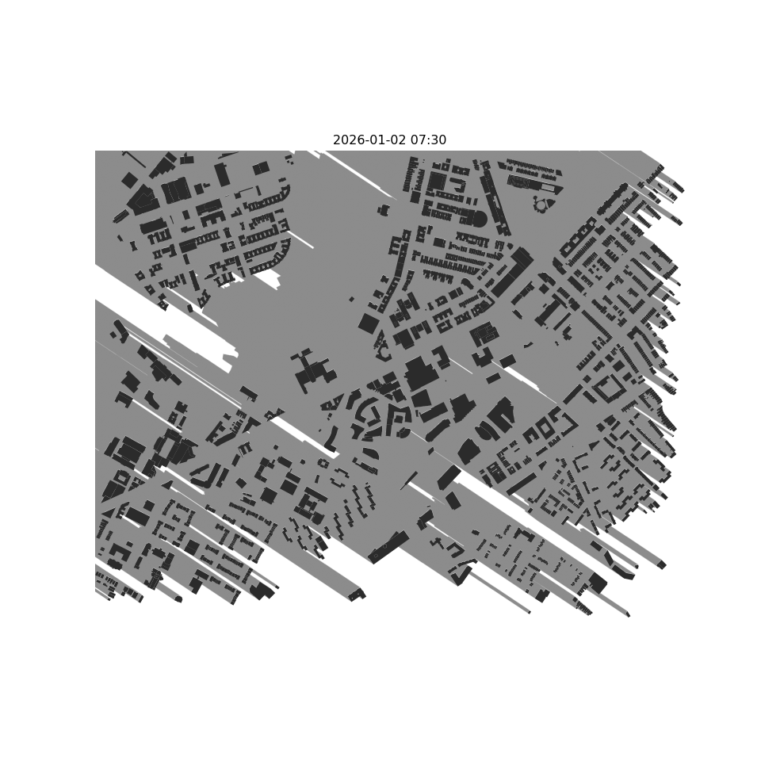

In this notebook I implement shadow calculations on one of the 3D geojson models that we generated for the Northeastern area. The algorithm I use is the one provided in the UMEP repo, which is part of a QGIS plugin. It is based on an geometrical calculation described by Carlo Ratti in a paper called: *Image Processing for Urban Scale Environmental Modelling*.


### Opening the data
```{python}
import geopandas as gpd
import matplotlib.pyplot as plt
import cmcrameri.cm as cmc
import numpy as np
import pvlib
from umep.util.shadowingfunctions import shadowingfunctionglobalradiation
import pandas as pd
from rasterio.features import rasterize
from rasterio.transform import from_origin
from rasterio.plot import show
```

```{python}
LOD_1_FILE_PATH = "/Users/legariapena.j/Documents/open-sensing-analysis/open-sensing-analysis/notebooks/2026_11_04_shadow_umep_tests/data/building_attributes.geojson"

gdf = gpd.read_file(LOD_1_FILE_PATH)
FEET_TO_METERS = 0.3048
gdf["reference_height"] = gdf["reference_height"] * FEET_TO_METERS

#Clip the heights.
PERCENTILE_MIN = 5
PERCENTILE_MAX = 95
all_heights = list(gdf["reference_height"])
min_percentile_value = np.nanpercentile(all_heights, PERCENTILE_MIN)
max_percentile_value = np.nanpercentile(all_heights, PERCENTILE_MAX)
print(min_percentile_value)
print(max_percentile_value)

ATTRIBUTE_TO_SHOW = "reference_height_clipped"
gdf[ATTRIBUTE_TO_SHOW] = gdf["reference_height"].clip(min_percentile_value, max_percentile_value)

fig, ax = plt.subplots(1,1, figsize = (10, 10))
gdf.plot(ax = ax, cmap = cmc.hawaii, column = ATTRIBUTE_TO_SHOW, legend = True)
ax.set_axis_off()
ax.set_title("Building height (meters)")

gdf.head()
```

### Rasterize the file
So far we have a vector file. We now need to rasterize it.

```{python}
buildings = gdf.to_crs(32619)
buildings = buildings[buildings["building_height"] > 0].sort_values("building_height")

PIXEL_SIZE = 1.0
minx, miny, maxx, maxy = buildings.total_bounds
width = int(np.ceil((maxx - minx) / PIXEL_SIZE))
height = int(np.ceil((maxy - miny) / PIXEL_SIZE))
transform = from_origin(minx, maxy, PIXEL_SIZE, PIXEL_SIZE)

dsm = rasterize(
    zip(buildings.geometry, buildings["building_height"]),
    out_shape = (height, width),
    transform = transform,
    fill = 0.0,
    dtype = "float32",
)

min_percentile_value = np.nanpercentile(buildings["building_height"], PERCENTILE_MIN)
max_percentile_value = np.nanpercentile(buildings["building_height"], PERCENTILE_MAX)
dsm_to_show = dsm.copy()
dsm_to_show[dsm_to_show[:,:] >= max_percentile_value] = max_percentile_value
dsm_to_show[(dsm_to_show[:,:] <= min_percentile_value) & (dsm_to_show[:,:] > 0)] = min_percentile_value
show(dsm_to_show, cmap = cmc.hawaii, title = "Heights (meters)")
```


### Apply the shadow calculation for multiple hours of today. 
```{python}
times = pd.date_range("2026-01-02 06:00", "2026-01-02 18:00", freq = "15min", tz = "America/New_York")
solar_position = pvlib.solarposition.get_solarposition(times, 42.339, -71.089)
solar_position = solar_position[solar_position["apparent_elevation"] > 0]
ALL_DATES = list(solar_position.index.strftime("%Y-%m-%d %H:%M"))
azimuth_values = list(solar_position["azimuth"])
altitude_values = list(solar_position["apparent_elevation"])

shadows = [shadowingfunctionglobalradiation(dsm, azimuth, altitude, 1 / PIXEL_SIZE, 1) for azimuth, altitude in zip(azimuth_values, altitude_values)]

shadows[0]
```

```{python}
fig, axes = plt.subplots(4, 4, figsize = (20, 20))
for ax, shadow, date in zip(axes.flat, shadows, ALL_DATES):
    show(shadow, ax = ax, transform = transform, cmap = "gray", vmin = 0, vmax = 1, adjust = False, title = date)
for ax in axes.flat:
    ax.set_axis_off()
```

#### Generating an animation. 

```{python}
from matplotlib import animation
from matplotlib.colors import ListedColormap
from rasterio.plot import plotting_extent
from IPython.display import Markdown

fig, ax = plt.subplots(1, 1, figsize = (10, 10))
image = ax.imshow(shadows[0], cmap = ListedColormap(["#8c8c8c", "white"]), vmin = 0, vmax = 1, extent = plotting_extent(dsm, transform))
buildings.plot(ax = ax, color = "#2b2b2b")
ax.set_axis_off()

def update(i):
    image.set_data(shadows[i])
    ax.set_title(ALL_DATES[i])
    return [image]

anim = animation.FuncAnimation(fig, update, frames = len(shadows), interval = 200)
anim.save("shadow_animation.gif", writer = "pillow", fps = 5)
plt.close(fig)
Markdown("")
```