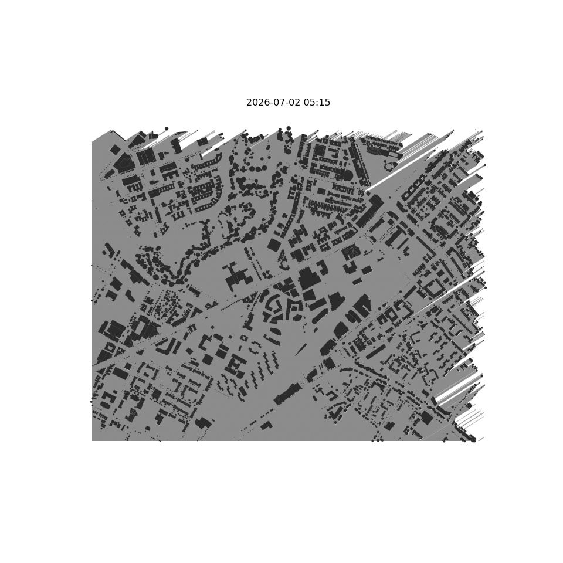

### Opening the data
```{python}
import geopandas as gpd
import matplotlib.pyplot as plt
import cmcrameri.cm as cmc
import numpy as np
import pandas as pd
import pvlib
from shapely.geometry import box
from umep.util.shadowingfunctions import shadowingfunctionglobalradiation
from rasterio.features import rasterize
from rasterio.transform import from_origin
from rasterio.plot import show, plotting_extent
from matplotlib import animation
from matplotlib.colors import ListedColormap
from IPython.display import Markdown

BUILDINGS_PATH = "/Users/legariapena.j/Documents/open-sensing-analysis/open-sensing-analysis/notebooks/2026_11_04_shadow_umep_tests/data/building_attributes.geojson"
TREE_CROWNS_PATH = "/Users/legariapena.j/Documents/open-sensing-analysis/open-sensing-analysis/notebooks/2026_11_04_shadow_umep_tests/data/tree_crowns.geojson"

buildings = gpd.read_file(BUILDINGS_PATH).to_crs(32619)
buildings = buildings[buildings["building_height"] > 0]
trees = gpd.read_file(TREE_CROWNS_PATH).to_crs(32619)

region = gpd.GeoDataFrame(geometry = [box(*buildings.total_bounds)], crs = buildings.crs)
trees_in_region = gpd.sjoin(trees, region, predicate = "intersects")

buildings = buildings.rename(columns = {"building_height": "height"})
trees_in_region = trees_in_region.rename(columns = {"tree_height": "height"})
all_elements_gdf = pd.concat(
    [buildings[["geometry", "height"]], trees_in_region[["geometry", "height"]]],
    ignore_index = True,
)

PERCENTILE_MIN = 5
PERCENTILE_MAX = 95
min_percentile_value = np.nanpercentile(all_elements_gdf["height"], PERCENTILE_MIN)
max_percentile_value = np.nanpercentile(all_elements_gdf["height"], PERCENTILE_MAX)
ATTRIBUTE_TO_SHOW = "height_clipped"
all_elements_gdf[ATTRIBUTE_TO_SHOW] = all_elements_gdf["height"].clip(min_percentile_value, max_percentile_value)

fig, ax = plt.subplots(1, 1, figsize = (10, 10))
all_elements_gdf.plot(ax = ax, cmap = cmc.hawaii, column = ATTRIBUTE_TO_SHOW, legend = True)
ax.set_axis_off()
ax.set_title("Height (meters)")

all_elements_gdf.head()
```

### Rasterize the file
```{python}
PIXEL_SIZE = 1.0
minx, miny, maxx, maxy = region.total_bounds
raster_width = int(np.ceil((maxx - minx) / PIXEL_SIZE))
raster_height = int(np.ceil((maxy - miny) / PIXEL_SIZE))
transform = from_origin(minx, maxy, PIXEL_SIZE, PIXEL_SIZE)

elements_tallest_last = all_elements_gdf.sort_values("height")
dsm = rasterize(
    zip(elements_tallest_last.geometry, elements_tallest_last["height"]),
    out_shape = (raster_height, raster_width),
    transform = transform,
    fill = 0.0,
    dtype = "float32",
)

dsm_to_show = dsm.copy()
dsm_to_show[dsm_to_show >= max_percentile_value] = max_percentile_value
dsm_to_show[(dsm_to_show <= min_percentile_value) & (dsm_to_show > 0)] = min_percentile_value
show(dsm_to_show, cmap = cmc.hawaii, title = "Heights (meters)")
```

### Apply the shadow calculation for multiple hours of the day
```{python}
times = pd.date_range("2026-07-02 04:00", "2026-07-02 21:00", freq = "15min", tz = "America/New_York")
solar_position = pvlib.solarposition.get_solarposition(times, 42.339, -71.089)
solar_position = solar_position[solar_position["apparent_elevation"] > 0]
ALL_DATES = list(solar_position.index.strftime("%Y-%m-%d %H:%M"))
azimuth_values = list(solar_position["azimuth"])
altitude_values = list(solar_position["apparent_elevation"])

shadows = [shadowingfunctionglobalradiation(dsm, azimuth, altitude, 1 / PIXEL_SIZE, 1) for azimuth, altitude in zip(azimuth_values, altitude_values)]

shadows[0]
```

#### Generating an animation
```{python}
fig, ax = plt.subplots(1, 1, figsize = (10, 10))
image = ax.imshow(shadows[0], cmap = ListedColormap(["#8c8c8c", "white"]), vmin = 0, vmax = 1, extent = plotting_extent(dsm, transform))
all_elements_gdf.plot(ax = ax, color = "#2b2b2b")
ax.set_axis_off()

def update(i):
    image.set_data(shadows[i])
    ax.set_title(ALL_DATES[i])
    return [image]

anim = animation.FuncAnimation(fig, update, frames = len(shadows), interval = 200)
anim.save("vegetation_plus_buildings_shadow_animation.gif", writer = "pillow", fps = 5)
plt.close(fig)
Markdown("")
```
